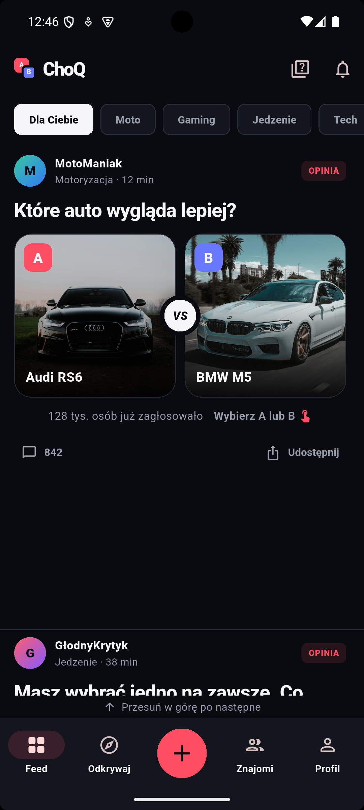
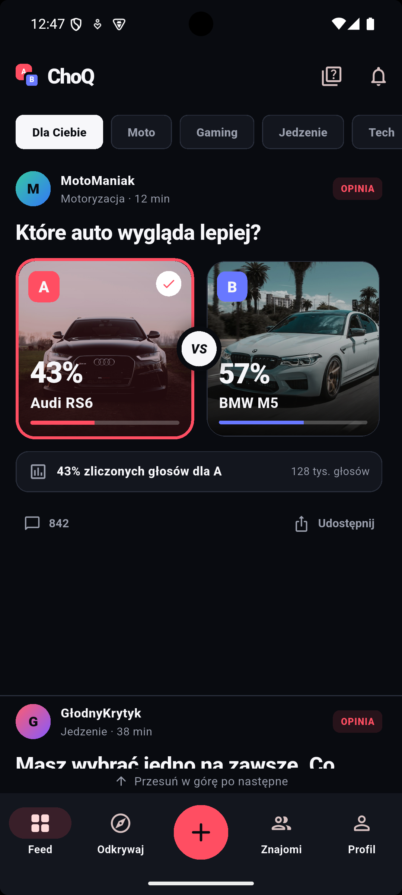
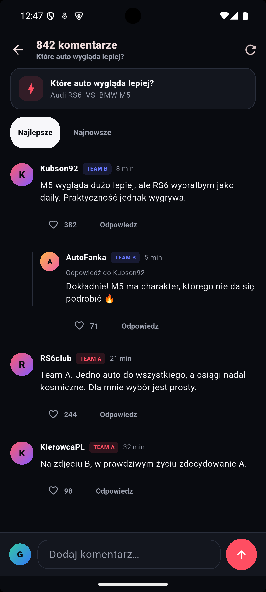
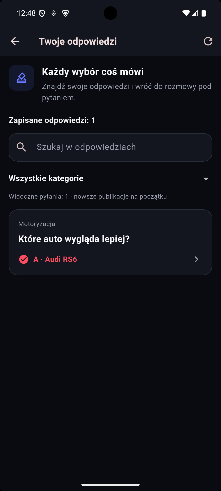

# ChoQ

Własny prototyp aplikacji społecznościowej opartej na wyborach A/B, rozwijany przy pomocy agentów AI.

## Pomysł

Użytkownik odpowiada na porównania i poznaje swoje preferencje. Projekt obejmuje głosowania, dyskusje i historię wyborów. Rozważany kierunek rozwoju profilu to humorystyczny portret wynikający z wielu odpowiedzi.

## Mój wkład

Określam funkcje, wymagania i kierunek rozwoju. Przykładowa decyzja dotyczy wspólnego głównego feedu i wykorzystania kategorii do porządkowania historii odpowiedzi w profilu. To zapisana decyzja kierunkowa; jej wpływ na użyteczność wymaga sprawdzenia z użytkownikami.

Agenci AI realizują implementację kolejnych wersji. Technologie projektu obejmują Flutter, Dart i Firebase. Nazwy technologii opisują prototyp i zakres współpracy z AI.

## Stan

Rozwijany lokalny prototyp z wersjami Android i środowiskiem emulatorów Firebase. 5 listopada 2026 zbudowano bieżącą wersję aplikacji i uruchomiono ją w emulatorze Androida ChoQ_API_35 w trybie mock. Sprawdzono poniższy scenariusz. Zrzuty pochodzą z ekranu emulatora, z zachowaniem proporcji 1080 × 2400. Zrzuty przedstawiają dane demonstracyjne: użytkownicy, komentarze, liczby głosów i statystyki profilu nie są dowodem rzeczywistego ruchu. Sprawdzenie obejmuje natywny interfejs Androida; nie obejmuje działania backendu Firebase.

## Wybór i porównanie odpowiedzi

Główny ekran przedstawia pytanie oraz dwie ilustrowane odpowiedzi. W sprawdzonej wersji są także widoczne filtry kategorii; wspólny feed pozostaje decyzją kierunkową dla dalszego rozwoju.

Po wybraniu Audi RS6 karta A została wyróżniona i pojawiły się demonstracyjne udziały odpowiedzi: 43% i 57%. To potwierdzenie działania interakcji w lokalnym prototypie.

## Dyskusja i powrót do wyborów

Panel dyskusji pokazuje komentarze, zagnieżdżoną odpowiedź, reakcje i opcje sortowania. Zrzut przedstawia istniejący wątek demonstracyjny; podczas tej próby nie sprawdzano publikacji nowego komentarza.

W historii pojawiła się odpowiedź oddana podczas próby. Ekran udostępnia wyszukiwanie i wybór kategorii. Profil i historia łączą pojedyncze decyzje z możliwością wrócenia do wcześniejszego pytania.

[Ekran powitalny](../materialy/choq-android/01-powitanie.png) · [Profil demonstracyjny](../materialy/choq-android/05-profil.png)

## Kolejne kierunki

Spójny, humorystyczny portret z wielu wyborów i rozwinięte porównywanie osób pozostają kierunkami produktu. Obecne ekrany i liczniki nie potwierdzają walidacji psychologicznej ani wdrożenia wszystkich planowanych funkcji.
