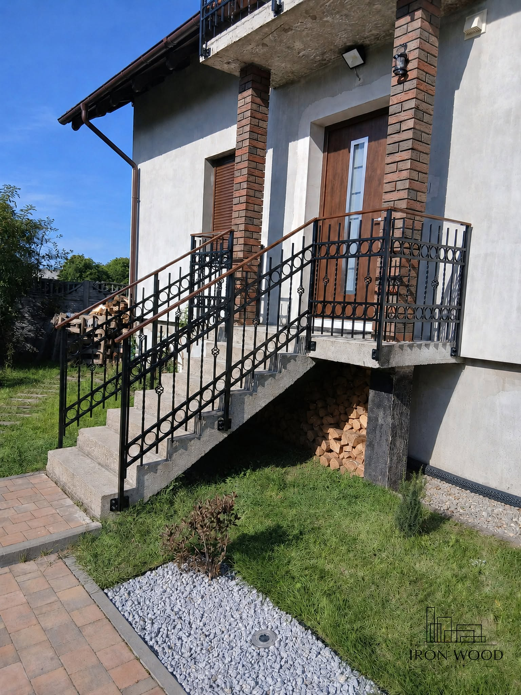
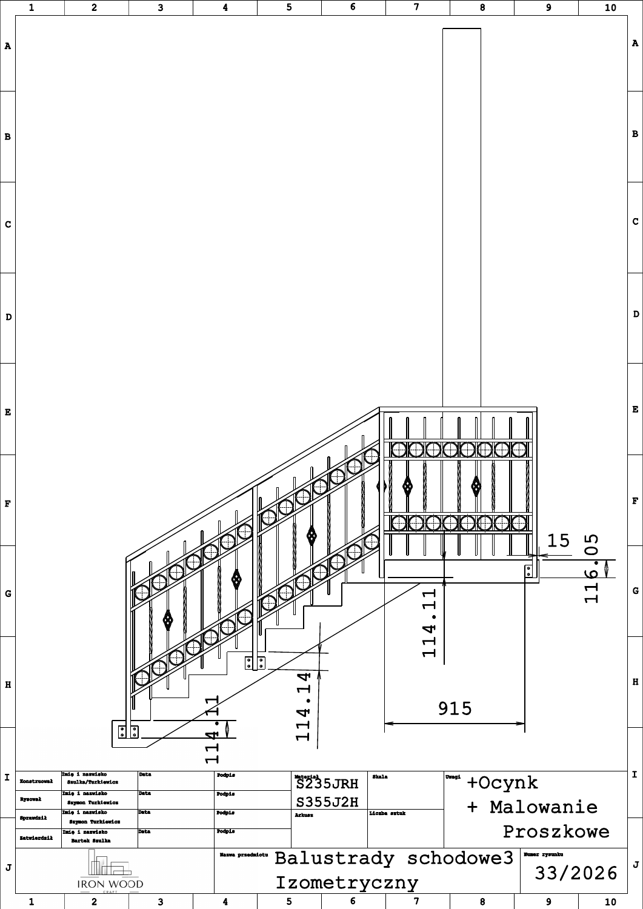

# IronWoodCraft — CAD i realizacje konstrukcji stalowych

W IronWoodCraft zajmuję się projektowaniem CAD i przygotowaniem dokumentacji konstrukcji stalowych. Rozwijam również stronę marki i przygotowałem sklep internetowy.

## Balustrady zewnętrzne — schody, podest i balkon

*Zdjęcie realizacji opublikowane na profilu IronWoodCraft.*

Zakres projektu obejmuje balustrady przy schodach wejściowych, podeście oraz balkonie. Dokumentacja rozdziela poszczególne odcinki konstrukcji i określa ich geometrię, wymiary oraz rozmieszczenie elementów.

Mój zakres obejmuje pracę w CAD i przygotowanie rysunków. Dokumentacja zawiera także oznaczenia innych uczestników projektu. Fotografia przedstawia rezultat realizacji IronWoodCraft.

## Od geometrii do dokumentacji

*Rysunek odcinka schodowego i podestu. Układ kółek oraz ozdobnych prętów odpowiada wariantowi widocznemu na zdjęciu.*

Na rysunku widoczne są:

- przebieg poręczy nad schodami i przejście do poziomego odcinka podestu;
- rozmieszczenie słupków, wypełnienia i elementów mocujących;
- wymiary montażowe oraz odniesienie konstrukcji do schodów;
- wskazane wykończenie: ocynk i malowanie proszkowe.

Materiały źródłowe obejmują modele CAD, rysunki złożeniowe balkonu i schodów oraz osobne modele części. Przykład pokazuje przygotowanie informacji potrzebnych do wykonania i montażu konstrukcji dopasowanej do istniejącego obiektu.

## Pozostała działalność

Przygotowuję również modele produktów i ich prezentacje. W materiałach marki występują zarówno wykonane konstrukcje, jak i niezrealizowane koncepcje. W tej karcie przedstawiono realizację i odpowiadający jej wariant dokumentacji.

Stronę marki prowadzę w Webflow. Uruchomienie katalogu i sklepu Shopify było kolejnym elementem prezentowania oferty w internecie.

## Źródła ilustracji

- [Zdjęcie realizacji — Facebook IronWoodCraft](https://www.facebook.com/photo/?fbid=122146510527115021).
- Rysunek: archiwum projektu IronWoodCraft, plik Schody1.pdf, folder dokumentacji montażowej. Podgląd PNG wygenerowany z pierwszej strony dokumentu.

[Strona IronWoodCraft](https://www.ironwoodcraft.pl/) · [Powrót do portfolio](../README.md)
