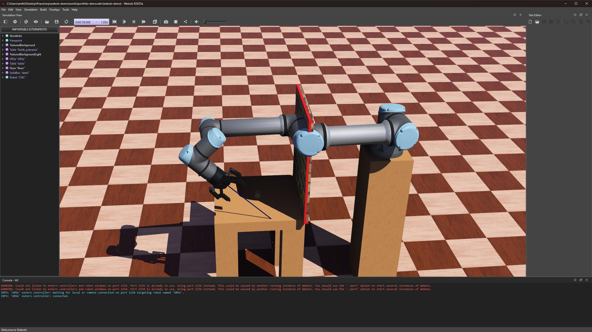

# Symulacja robotyki w Webots

Projekt edukacyjny w toku. Środowisko Webots, Python, model ramienia UR5e i chwytaka.

[Próbka kontrolera i opis jego wymagań](../przyklady/webots/README.md)

## Widok środowiska

Zrzut z uruchomionego Webots R2025a, 5 listopada 2026. Scena zawiera model UR5e, chwytak Robotiq, stolik, detal oraz uproszczony panel drzwi CNC. To ilustracja obecnego etapu budowy stanowiska.

## Cel

Stopniowe poznawanie logiki sterowania przez budowę symulacji obsługi stanowiska CNC.

## Dotychczasowy zakres

- Ćwiczenia ruchów przegubów i odczytu czujników.
- Sekwencja pobrania i odłożenia detalu, której działanie potwierdziłem podczas nauki.
- Oddzielny kontroler symulowanych drzwi CNC z pomiarem pozycji, tolerancją i limitem oczekiwania.
- Sprawdzenie scenariusza osiągnięcia celu oraz przekroczenia czasu.

## Mój udział

Piszę fragmenty kodu jako ćwiczenia, korzystając ze słownego pseudokodu, wyjaśnień i pomocy w diagnozowaniu błędów. Ćwiczę pętle, warunki, flagi stanu i interpretację pomiarów.

## Aktualna granica projektu

Integracja potwierdzenia otwarcia drzwi z ramieniem i pełny wspólny cykl pozostają w toku. Opis dotyczy symulacji edukacyjnej. Podnoszenie i odkładanie zostało wcześniej potwierdzone podczas moich prób i zapisane w historii nauki.

Podczas ponownego uruchomienia 5 listopada 2026 sprawdzono otwarcie sceny oraz wykonanie bieżącej próby kontrolera drzwi, zakończonej komunikatem przekroczenia limitu czasu. Osobna kopia demonstracyjna z kontrolerem ramienia uruchamianym zewnętrznie połączyła się z Webots. W tej sesji nie potwierdzono pełnej sekwencji pobrania i odłożenia, więc zrzut nie jest dowodem ukończenia cyklu.
