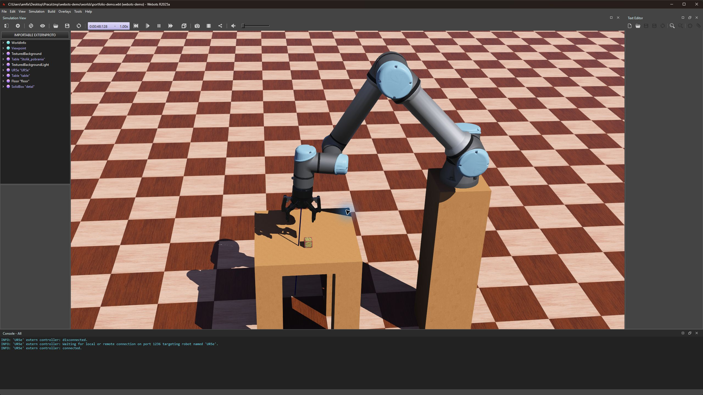

# Symulacja robotyki w Webots

Projekt edukacyjny w toku. Środowisko Webots, Python, model ramienia UR5e i chwytaka.

[Próbka kontrolera i opis jego wymagań](../przyklady/webots/README.md)

## Demonstracja ramienia

Zrzuty z rzeczywistej próby w Webots R2025a, 5 listopada 2026. Kontroler wykonał pozycje podejścia, zamknięcie chwytaka, podniesienie, zmianę pozycji, otwarcie chwytaka i wycofanie. Program zakończył się komunikatem „Koniec symulacji”.

Próbę wykonano w osobnej kopii sceny, z usuniętym panelem CNC, jako samodzielną demonstrację ramienia. Kod kontrolera ramienia pozostał identyczny z kodem ćwiczeń. Z panelem obecnym w scenie pierwsza pozycja nie została osiągnięta. Integracja stanowiska wymaga dalszej pracy.

## Cel

Stopniowe poznawanie logiki sterowania przez budowę symulacji obsługi stanowiska CNC.

## Dotychczasowy zakres

- Ćwiczenia ruchów przegubów i odczytu czujników.
- Sekwencja pobrania i odłożenia detalu, której działanie potwierdziłem podczas nauki.
- Oddzielny kontroler symulowanych drzwi CNC z pomiarem pozycji, tolerancją i limitem oczekiwania.
- Sprawdzenie scenariusza osiągnięcia celu oraz przekroczenia czasu.

## Mój udział

Piszę fragmenty kodu jako ćwiczenia, korzystając ze słownego pseudokodu, wyjaśnień i pomocy w diagnozowaniu błędów. Ćwiczę pętle, warunki, flagi stanu i interpretację pomiarów.

## Aktualna granica projektu

Integracja potwierdzenia otwarcia drzwi z ramieniem i pełny wspólny cykl pozostają w toku. Opis dotyczy symulacji edukacyjnej. Podnoszenie i odkładanie zostało wcześniej potwierdzone podczas moich prób i zapisane w historii nauki.

Podczas ponownego uruchomienia 5 listopada 2026 sprawdzono także bieżącą próbę kontrolera drzwi, zakończoną komunikatem przekroczenia limitu czasu. Kontroler ramienia działa zewnętrznie, z biblioteką Webots w środowisku Pythona. W demonstracji zastosowano jawne połączenie do portu osobnej instancji Webots. Umowne sygnały gotowości CNC w kodzie ramienia zależą nadal od czasu; nie są rzeczywistym potwierdzeniem położenia drzwi.
